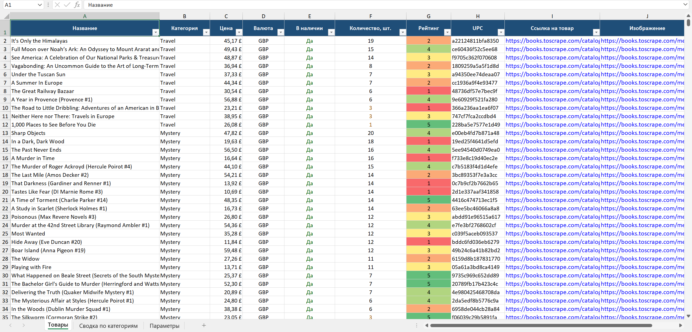
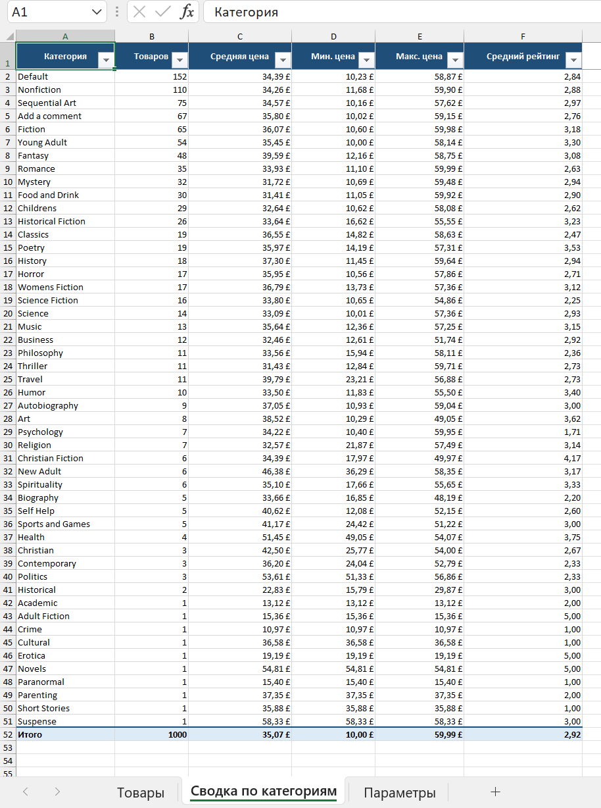

# catalog-parser-excel

Парсер каталога товаров с выгрузкой в оформленный Excel. Демо-проект на учебном сайте
[books.toscrape.com](https://books.toscrape.com) — тот же подход подходит для любого
статического интернет-магазина.

## Что делает

- Собирает весь каталог (1000 товаров за ~40 секунд) или одну категорию: название, цену
  (число + валюта), наличие, рейтинг 1–5, категорию, ссылки на товар и изображение.
- В режиме `--details` заходит на страницу каждого товара: точный остаток на складе и UPC.
- Выгружает в Excel с тремя листами: «Товары», «Сводка по категориям», «Параметры» —
  цветная шапка, фильтры, закреплённая строка, кликабельные ссылки, подсветка рейтинга
  и наличия.
- Работает аккуратно с сайтом: пауза между запросами, свой User-Agent, повторы
  с экспоненциальной задержкой при сбоях сети, 5xx и 429.
- Не падает из-за одного «битого» товара: пропускает его и пишет причину в лог
  (`logs/parser.log`).

## Пример результата

Лист «Товары» (`--max-pages 3 --details`, реальный скриншот Excel):



Лист «Сводка по категориям» (весь каталог, 1000 товаров, 50 категорий):



Файлы реальных прогонов: [example_travel.xlsx](docs/example_travel.xlsx),
[example_catalog_3pages.xlsx](docs/example_catalog_3pages.xlsx),
[example_catalog_full.xlsx](docs/example_catalog_full.xlsx),
лог консоли — [console_output.txt](docs/console_output.txt):

```text
> python -m catalog_parser --category Travel --details --output docs/example_travel.xlsx
03:55:55 INFO    Старт: категория «Travel», лимит страниц: нет, детали: да
03:56:02 INFO    «Travel», стр. 1: товаров 11 (всего собрано 11)
03:56:02 INFO    Готово: товаров 11, категорий 1, страниц листинга 1, HTTP-запросов 13, пропущено 0, время 7.0 с
03:56:02 INFO    Excel сохранён: docs\example_travel.xlsx
```

## Стек

Python 3.12+ · httpx · BeautifulSoup4 + lxml · openpyxl · pytest · ruff · mypy (strict)

## Установка и запуск (PowerShell)

```powershell
python -m venv .venv
.\.venv\Scripts\Activate.ps1
pip install -r requirements-dev.txt     # для работы без тестов хватит requirements.txt

python -m catalog_parser --list-categories
python -m catalog_parser --category "Travel" --details --output docs/example_travel.xlsx
python -m catalog_parser --max-pages 3
python -m catalog_parser                # весь каталог -> output/books_<дата>_<время>.xlsx
```

| Параметр | Что делает |
|---|---|
| `--category "Travel"` | одна категория по названию (регистр не важен); без параметра — весь каталог |
| `--list-categories` | вывести список категорий и выйти |
| `--max-pages N` | лимит страниц листинга на прогон |
| `--details` | заходить на страницу каждого товара: остаток на складе и UPC |
| `--output books.xlsx` | файл вывода (по умолчанию `output/books_<дата>_<время>.xlsx`) |
| `--delay 0.5` | пауза между запросами, секунд |
| `--retries 3` | число повторов при сетевых ошибках, таймаутах, 5xx и 429 |
| `--timeout 15` | таймаут одного запроса, секунд |
| `--log-level INFO` | DEBUG / INFO / WARNING / ERROR |
| `--log-file logs/parser.log` | файл лога |

Весь каталог обходится по категориям — так категория известна для каждого товара сразу,
без захода на его страницу. Ctrl+C останавливает обход и сохраняет уже собранное.

## Тесты

```powershell
pytest -q        # 89 тестов, без сети: настоящие HTML-страницы сайта лежат в tests/fixtures
ruff check .     # линтер
mypy             # проверка типов (strict)
```

Тесты проверяют разбор страниц (цены, рейтинг, абсолютные ссылки, пагинация, остаток),
повторы HTTP-клиента через `httpx.MockTransport`, обход категорий, оформление и сводку
в Excel, аргументы CLI и сквозной прогон `main()`. Сеть в тестах заблокирована.

## Структура проекта

```text
catalog_parser/
  __main__.py     точка входа: python -m catalog_parser
  cli.py          аргументы командной строки, логирование, сценарий запуска
  http.py         HTTP-клиент: таймауты, User-Agent, пауза, повторы
  parsers.py      разбор HTML -> dataclass (чистые функции, без сети)
  models.py       модели: Category, Book, ProductDetails
  scraper.py      обход категорий и страниц, режим --details
  summary.py      агрегаты для листа «Сводка по категориям»
  excel.py        выгрузка и оформление .xlsx
tests/            pytest + fixtures/ с сохранёнными страницами сайта
scripts/          обновление фикстур, скриншоты Excel для docs/
docs/             примеры результатов: xlsx, скриншоты, лог консоли
```

## Лицензия

[MIT](LICENSE) © 2026 Vladimir
